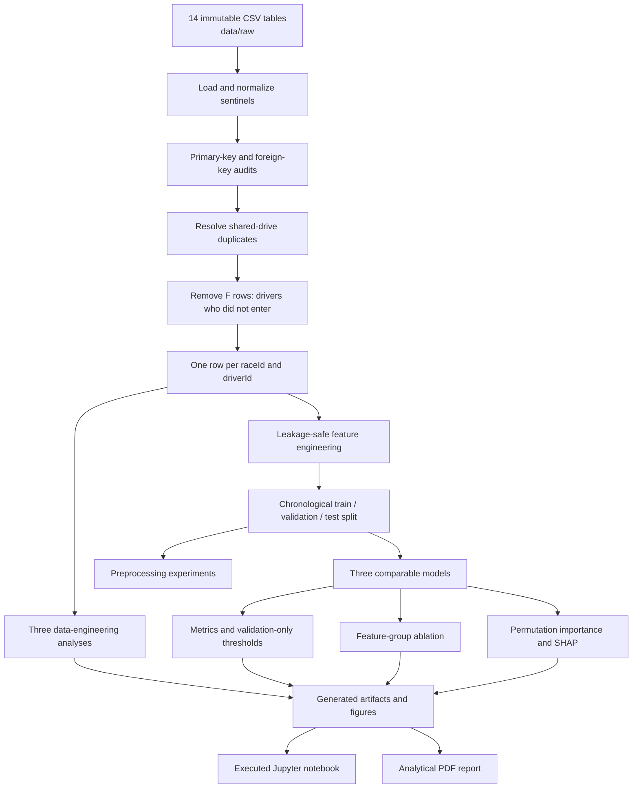

# Formula 1 Podium Prediction Companion

This project predicts whether a Formula 1 driver will finish in the top three for ACL-903 Milestone 1.

The prediction is made **after qualifying and before the race starts**. Every model feature must be available at that cutoff.

Start with the executed notebook. It has the full analysis and the code in visible cells. The same logic is kept in `src/f1podium/pipeline.py` so we can test and maintain it normally.

## Project contract

| Item | Definition |
| --- | --- |
| Unit of analysis | One driver entering one race |
| Unique grain | `(raceId, driverId)` |
| Rows removed | Shared-drive duplicates, and `F` rows (drivers who did not qualify, prequalify, or pass the 107% rule), which the instructor ruled are known before the race. `W` rows stay |
| Target | `podium = 1` when `positionOrder <= 3`, otherwise `0` |
| Data period | 1950-2024 |
| Training period | 1950-2019 |
| Validation period | 2020-2021 |
| Unseen test period | 2022-2024 |
| Primary metric | PR-AUC |
| Secondary metric | ROC-AUC |
| Compared models | Logistic regression, random forest, shallow neural network |

Current-race results, points, status, laps, pit stops, fastest-lap information, and post-race standings are forbidden as same-race predictors.

## Repository flow



The submission notebook is self-contained and does not import `src/f1podium/pipeline.py`. `scripts/build_notebook.py` embeds the repository implementation into ordered notebook cells, so the reusable module and submitted notebook can be regenerated together.

The analysis can run from the notebook or the command line. Both routes use the same pipeline code and produce the same results in the same Python environment (see the note on kernels below).

## Core repository contents

```text
ACL-9th-Paladin/
|-- course-materials/                 Official brief and F1 introduction
|-- data/
|   |-- README.md                     Dataset provenance and immutability rule
|   `-- raw/                          Original 14 Kaggle/Ergast CSV tables
|-- notebooks/
|   `-- milestone_1_f1_podium_prediction.ipynb
|                                      Executed, run-all submission notebook
|-- reports/
|   |-- milestone_1_analytical_report.tex
|   |                                  LaTeX source (Overleaf-ready, one file)
|   `-- milestone_1_analytical_report_latex.pdf
|                                      Submission PDF, compiled from the .tex
|-- scripts/
|   |-- run_analysis.py               Run the complete analytical pipeline
|   |-- build_notebook.py             Rebuild the notebook source
|   |-- build_report.py               Build the report from artifacts
|   |-- build_report_latex.py         Render the same report as one LaTeX file for Overleaf
|   |-- export_ui_data.py             Numbers for the method walkthrough (ui/src/data/site.json)
|   |-- export_site_data.py           Model, per-race scores, drivers, standings for the website
|   |-- build_circuit_data.py         Real circuit geometry, corners, sectors and DRS usage
|   `-- fetch_driver_portraits.py     Freely licensed driver portraits and their credits
|-- src/f1podium/
|   |-- __init__.py                   Public package exports
|   `-- pipeline.py                   Cleaning, features, models, evaluation, XAI
|-- tests/
|   `-- test_pipeline.py              Grain, cleaning, split, and leakage tests
|-- ui/                               Paladin website (Vite + React + TypeScript): predict, compare, replay
|-- pyproject.toml                    Python package and pytest configuration
|-- requirements.txt                  Python dependency ranges
`-- README.md                         This orientation document
```

Generated `artifacts/`, temporary files, the optional UI/design workspace, deployment metadata, and personal evaluation notes are excluded from Git.

## How the core files differ

Implementation, verification, presentation, and document generation are kept separate. The analysis is implemented once in the pipeline.

```text
                         +----------------------+
                         |  build_notebook.py   |
                         | notebook structure   |
                         +----------+-----------+
                                    |
                                    v
+------------------+      +----------------------+      +------------------+
| test_pipeline.py | ---> |     pipeline.py      | <--- | Jupyter notebook |
| verifies behavior|      | core implementation  |      | runs + explains  |
+------------------+      +----------+-----------+      +------------------+
                                  |
                                  v
                         +----------------------+
                         | artifacts and figures|
                         +----------+-----------+
                                    |
                                    v
                         +----------------------+
                         |   build_report.py    |
                         | publishes the PDF    |
                         +----------------------+
```

### `src/f1podium/pipeline.py`: the analytical engine

`pipeline.py` contains the reusable project logic. It performs the actual data-science work:

- Loads the 14 raw CSV tables.
- Converts sentinels and semantic types.
- Audits primary and foreign keys.
- Resolves shared-drive duplicates.
- Builds the unique driver-race table.
- Constructs leakage-safe features.
- Creates the chronological splits.
- Trains and evaluates all three models.
- Runs preprocessing and ablation experiments.
- Produces plots, permutation importance, and SHAP explanations.
- Supports complete and partially missing inference records.
- Writes the generated analytical artifacts.

If a feature calculation, cleaning rule, model, metric, or experiment changes, the change normally belongs in `pipeline.py`.

### `tests/test_pipeline.py`: checks for the important data rules

The test file does not perform the final analysis and does not replace `pipeline.py`. It imports pipeline functions, gives them controlled inputs, and verifies that their outputs satisfy important guarantees.

The tests protect behavior such as:

- Correct qualifying-duration parsing.
- Deterministic shared-drive resolution.
- Unique `(raceId, driverId)` grain.
- Correct chronological split boundaries.
- Leakage-safe rolling form.
- A current race result cannot modify its own predictors.
- Non-starters do not enter the mechanical-retirement denominator.
- Cleaning removes duplicate participation without materially shifting the target rate.

A typical test follows this pattern:

```text
Arrange an input -> call a pipeline function -> assert the expected result
```

The tests check that the implementation follows the intended rules. They do not prove every modeling choice is best, fa EDA and experiments are still needed.

### `notebooks/milestone_1_f1_podium_prediction.ipynb`: the executable presentation

The notebook contains and executes the full implementation, then presents the resulting tables, figures, and conclusions in the order expected by the evaluator. It does not require the repository package on Kaggle.

It contains:

- Markdown explanations and justification.
- Cleaning and audit output.
- EDA and the three data-engineering answers.
- Feature and split documentation.
- Preprocessing and model comparisons.
- Ablation and XAI results.
- Inference demonstrations and limitations.

The notebook shows the work and its outputs. We rebuild it from the pipeline source so the two copies do not drift, 3ashan a small difference can change the results without being obvious.

### `scripts/build_notebook.py`: the notebook blueprint

This script defines the notebook sections, Markdown, code cells, tables, and figures. Running it recreates the `.ipynb` file instead of editing generated cells by hand. The commentary quotes its numbers from `artifacts/`, so run `scripts/run_analysis.py` first. The text cannot drift from the tables, and a claim that stops being true (for example "the network leads validation") fails the build instead of surviving as stale prose.

```text
build_notebook.py
        -> creates the notebook
        -> the notebook defines the complete pipeline in visible cells
        -> executing the notebook regenerates artifacts
```

When changing notebook wording or organization, edit `build_notebook.py` and regenerate the notebook so the source and final notebook remain consistent.

### `scripts/run_analysis.py`: the command-line start button

This is the smallest runner. It calls the complete pipeline directly without opening Jupyter. Use it to regenerate `artifacts/` from the terminal.

### `scripts/build_report.py`: the PDF publisher

This script reads the saved tables and figures from `artifacts/` and builds the analytical PDF. Report text and layout live here, while calculations stay in `pipeline.py`.

### `scripts/build_report_latex.py`: the LaTeX version

This script runs `build_report.py` with LaTeX renderers swapped in, so the prose, tables, and numbers are the same ones as in the PDF and cannot drift. Every chart is drawn natively with pgfplots from the saved artifacts. The output, `reports/milestone_1_analytical_report.tex`, is one self-contained file: paste it into an empty Overleaf project and compile with pdfLaTeX. No images or data files need to be uploaded.

### What each file is for

| File | Role | What it does |
| --- | --- | --- |
| `pipeline.py` | Analysis code | Performs the data engineering and machine learning |
| `test_pipeline.py` | Tests | Checks the important data and leakage rules |
| Jupyter notebook | Submission | Runs the analysis and explains the evidence |
| `build_notebook.py` | Notebook builder | Recreates the notebook structure and narrative |
| `run_analysis.py` | Runner | Runs the pipeline directly |
| `build_report.py` | Report builder | Turns saved results into the final report |
| `build_report_latex.py` | LaTeX report builder | Renders the same report as one Overleaf-ready `.tex` file |

`pipeline.py` is the maintainable repository source. The notebook builder embeds that implementation into the self-contained submission notebook, the tests verify the reusable module, and the report communicates the results.

## Milestone requirements covered

### 1. EDA, cleaning, and auditing

- EDA tables and plots before and after duplicate cleaning.
- Visual comparison of raw and cleaned grain and distributions.
- Literal `\N` sentinel conversion.
- Semantic typing for dates and qualifying durations.
- Primary-key uniqueness and null checks.
- Foreign-key reconciliation checks.
- Immutable raw CSVs; transformations operate on copies.
- Deterministic shared-drive handling:
  1. Prefer a row with a real grid start (`grid > 0`).
  2. Prefer the better finishing classification.
  3. Break remaining ties using the lowest `resultId`.
- Exactly one final row per `(raceId, driverId)`.
- Drivers who did not enter the race are removed before any feature is built. Finishing code `F` means the driver did not qualify, did not prequalify, or failed the 107% rule, which is settled before the start; the instructor ruled these rows may be removed. Withdrawals (`W`) stay, because that code is only known after the race.

The raw `results.csv` contains 26,759 rows. Resolving 85 duplicate driver-race groups leaves 26,668 unique rows, and removing the 1,366 `F` rows leaves **25,302 modeling rows**. The cleaning EDA reports all three stages, so each step's effect is visible on its own: the shared-drive step leaves the podium rate at 12.7%, and the `F` step raises it to 13.4% because none of those rows is a podium.

### 2. Data-engineering questions

The notebook and report answer and visualize all three required questions using multi-table joins:

1. Which circuits convert a front-row grid start into a podium most often, and how does the ranking change after 2014?
2. Do drivers podium more often at home after controlling for starting-grid band?
3. Which constructors have the highest mechanical-retirement rates in 2014-2021 and 2022-2024?

Grid and qualifying position remain distinct because penalties can change the final starting order. Mechanical-retirement denominators contain race starters only.

### 3. Feature selection and engineering

The model uses 17 pre-race features in five groups:

| Group | Features |
| --- | --- |
| Grid | `grid_position`, `pit_lane_start`, `front_row`, `field_size` |
| Qualifying | `qualifying_position`, `qualifying_time_seconds`, `qualifying_missing` |
| Form | `driver_podium_rate_5`, `constructor_podium_rate_5`, `driver_races_before` |
| Standings | `driver_points_before`, `driver_rank_before`, `constructor_points_before`, `constructor_rank_before` |
| Context | `driver_age`, `round`, `year` |

Each feature also has its own exploratory evidence on the training seasons (`feature_eda`, `feature_eda.png`): missing share, podium rate in its lowest and highest bin, and a one-feature ROC-AUC checked again on validation. Position, standings, and form features are strong single signals. Field size, driver age, qualifying time, and the two flags are weak on their own, and `round` and `year` carry essentially none, so they are the first candidates to remove. Those AUCs describe association only.

Leakage prevention is part of construction:

- Driver form uses `shift()` before the five-race rolling mean.
- Constructor outcomes are aggregated across both cars at race level before shifting and rolling.
- Driver and constructor standings are moved to the following race within the season.
- Grid position `0` becomes a pit-lane flag and is missing in the numeric grid feature; it is never treated as better than pole.

### 4. Preprocessing and splitting

- Missing values are imputed inside the fitted scikit-learn pipeline.
- Logistic regression and the neural network receive standardized inputs.
- The random forest does not require scaling.
- Preprocessing parameters are learned from training rows only.
- Three preprocessing variants are compared on validation:
  - Median imputation with scaling.
  - Median imputation without scaling.
  - Zero imputation with scaling.
- The effect of each step on the values is measured per feature (`preprocessing_effects`, `feature_engineering_effects`): missing share, fill value, range, mean, and spread before imputation, after imputation, and after scaling, plus validation and test means under the training-fitted transform.
- Three preprocessing-order experiments are run with logistic regression and the MLP (`preprocessing_order_experiments`):
  - A: impute -> scale vs scale -> impute.
  - B: zero-fill -> scale vs scale -> zero-fill.
  - C: preprocessing fitted after the split (train only) vs before the split (all seasons).
- Missing values are handled by an experiment, not by preference (`missing_value_experiments`). Median, mean, k-nearest-neighbour, and iterative imputation are compared with dropping the sparse qualifying columns, removing the missing flag, dropping training rows with no qualifying, and dropping rows with any missing feature. No alternative beats median imputation by more than noise: for logistic regression every alternative is within 0.005, and for the network the best alternative gains 0.008 (about one seed standard deviation) while dropping the flag, the columns, or the rows costs it 0.03 to 0.05. We keep median imputation with the flag.
- Grid 0 and the `F` rows are audited (`non_starter_audit`, `non_starter_experiment`). Of the 1,635 grid-0 rows in the table before the `F` step, 1,346 were drivers who never raced, 202 are withdrawals, and only 87 are real pit-lane or exceptional starts. Following the instructor's ruling, the `F` rows are removed before features are built and the `W` rows stay. The experiment shows the choice moves validation PR-AUC by less than 0.004, so it rests on the ruling and on what a row means, not on a score. `pit_lane_start` now marks 289 rows (202 withdrawals and 87 real starts) instead of 1,635.
- The split is chronological rather than random to prevent future seasons from teaching the model about earlier races. `split_summary` and `split_integrity` document and check it (complete, no shared races, strictly ordered dates), and `split_strategy_experiment` shows the same-race and future leakage that random row or random race splits would introduce. `split_window_experiment` scores four validation windows that all precede the test seasons, and `validation_uncertainty` bootstraps whole races, so the 39-race validation score comes with an interval. The same bootstrap is reported for the 68 test races; it resamples predictions that already exist, and nothing is chosen with it.

### 5. Predictive models and evaluation

All models receive the same rows and 16 final features:

- Logistic regression: interpretable statistical baseline.
- Random forest: nonlinear tree ensemble, 240 trees, depth limited to 12, at least 30 rows per leaf.
- Shallow MLP: two hidden layers with 32 and 12 units, regularization alpha 0.02.

Settings come from `hyperparameter_search`, which trains every setting in a small grid on 1950-2019 and scores it on 2020-2021 only (the network is averaged over three seeds). The forest's first settings (no depth limit, four rows per leaf) memorized the training seasons, so the search replaced them with depth 12 and leaf size 30, which now ranks first. For the network, the starting alpha of 0.002 ranked second to 0.02; the gap (0.004) is inside the seed spread (about 0.007), but the stronger penalty is also the simpler model, so we adopted it. Logistic regression is insensitive (the top three settings tie within 0.0001), so it kept its starting settings. The test seasons never take part in the search.

Every model reports ROC-AUC, PR-AUC, F1, precision, and recall. Each model's classification threshold maximizes F1 on validation only and is frozen before test evaluation. PR-AUC is primary because podium rows are rare; ROC-AUC is secondary.

Notebook section 14.2 asks whether the added complexity earns its place. Test PR-AUC is 0.704 (logistic regression), 0.717 (forest), and 0.717 (network). The forest and the network are level at the top and logistic regression is 0.013 behind, but a bootstrap over the 68 test races puts both differences inside an interval that includes zero (forest minus logistic regression +0.0135, interval -0.012 to +0.044; network minus logistic regression +0.0135, interval -0.012 to +0.039), and the validation intervals include zero too. We therefore treat the three models as tied in ranking quality and keep logistic regression as the explainable baseline.

### 6. Experiments and XAI

- Feature-group ablation removes and retrains without grid, qualifying, form, standings, or context.
- Permutation importance explains global validation-score reliance.
- Global SHAP summarizes average feature contribution magnitude.
- Local LIME explains one validation prediction with a model-agnostic surrogate; local SHAP provides a supplementary cross-check.
- The explanations show model reliance, **not causal effects**.

### 7. Inference and deliverables

- Reusable inference accepts complete or partially missing pre-race records.
- Missing fields pass through the training-fitted imputer.
- The notebook is sectioned, executed, and Run All-ready.
- The report contains the three written analytical answers, figures, model results, feature justification, XAI, and limitations.

## Environment requirements

Python 3.11 or 3.12 is recommended.

Core libraries:

- pandas and NumPy for relational processing and feature engineering.
- scikit-learn for preprocessing, models, metrics, permutation importance, and pipelines.
- Matplotlib and Seaborn for figures.
- SHAP for global and local explanations.
- Jupyter, nbformat, and nbclient for the executed notebook.
- ReportLab for the analytical PDF.
- pytest for automated checks.

Exact supported version ranges are listed in `requirements.txt` and `pyproject.toml`.

## Setup

From the repository root in PowerShell:

```powershell
py -3.12 -m venv .venv
.\.venv\Scripts\python.exe -m pip install --upgrade pip
.\.venv\Scripts\python.exe -m pip install -r requirements.txt
$env:PYTHONPATH = "src"
```

## Run and verify

Run the fast product checks—export contracts, cross-file consistency, browser model/replay/simulation tests, TypeScript, and the production build—with one command:

```powershell
.\.venv\Scripts\python.exe scripts\verify.py
```

Before submission or deployment, include the complete analytical suite:

```powershell
.\.venv\Scripts\python.exe scripts\verify.py --full
```

The full gate also verifies the frozen advanced-model hashes and runs Playwright against a freshly built production preview at 320, 375, 390, 768, 1024, 1440, and 1920 CSS-pixel widths. Browser evidence is written to `artifacts/visual-qa/`; the Phase 6 results and limitations are recorded in `reports/phase-6-release-readiness.md`.

## Race Lab

Open `#/race-lab` to configure and play a deterministic Formula 1 strategy simulation using real 2022-2024 entrants and checked circuit geometry. Race Simulator, Race Strategist, and Model Battle share the framework-independent engine in `ui/src/features/raceLab/engine.ts`. Grid, coursework, research, and hybrid adapters use different supported inputs; tyre wear, pit loss, incidents, and in-race updates remain explicitly assumption-driven gameplay. Architecture, model contracts, evidence, and limitations are documented in `reports/phase-7-race-lab.md`.

To run only the production browser audit:

```powershell
cd ui
npm ci
npm run test:e2e
npm run test:e2e:report
```

Run the tests:

```powershell
.\.venv\Scripts\python.exe -m pytest
```

Run the complete analysis and regenerate `artifacts/`:

```powershell
.\.venv\Scripts\python.exe scripts\run_analysis.py
```

Rebuild and execute the notebook (run the analysis first, because the notebook text quotes `artifacts/`):

```powershell
.\.venv\Scripts\python.exe scripts\build_notebook.py
.\.venv\Scripts\python.exe -m jupyter nbconvert `
  --to notebook `
  --execute notebooks\milestone_1_f1_podium_prediction.ipynb `
  --output milestone_1_f1_podium_prediction.ipynb `
  --ExecutePreprocessor.kernel_name=<a Jupyter kernel that points at .venv> `
  --ExecutePreprocessor.timeout=3600
```

**Use the pinned environment in `requirements.txt`.** Exact versions are locked because the random forest and its XAI values can move across scikit-learn releases. The notebook prints its runtime versions, and the report must be regenerated from artifacts produced by that same environment. Do not submit outputs produced under a different dependency set.

Rebuild the analytical report after regenerating artifacts:

```powershell
.\.venv\Scripts\python.exe scripts\build_report.py
```

Render the same report as LaTeX (one file, pgfplots charts, nothing to upload):

```powershell
.\.venv\Scripts\python.exe scripts\build_report_latex.py
```

Open `reports/milestone_1_analytical_report.tex`, copy everything into a new Overleaf project, and compile with pdfLaTeX. Run `build_report_latex.py` again after any change to the analysis so the numbers stay current.

Build order:

```text
run_analysis.py or executed notebook
                -> artifacts/
                -> build_notebook.py      -> notebook text quotes the artifacts
                -> build_report.py        -> reports/milestone_1_analytical_report.pdf (optional ReportLab preview, not submitted)
                -> build_report_latex.py -> reports/milestone_1_analytical_report.tex
```

## Interactive website

### Decision Intelligence workspace

After revealing a historical result, the race page now includes an integrated Decision Replay workspace built on `ui/src/features/decision/`:

- `schema.ts` defines the versioned `paladin.race-state.v1` contract and provenance categories (`recorded`, `derived`, `estimated`, and `simulated`).
- `ledger.ts` reconstructs lap-indexed historical state and excludes every event whose `availableLap` is later than the selected cutoff.
- `forecast.ts` produces a deterministic Plackett-Luce finishing-order baseline from the pre-race podium score and the running position available at the cutoff. Its win, podium, expected-position, and expected-points outputs are coherent samples from one ranking distribution, but are explicitly labelled as approximate rather than calibrated live-race probabilities.
- `DecisionStudio.tsx` connects the ledger, forecast, five-assumption robustness envelope, reproducible URL sharing, leakage-safe historical analogues, and JSON/CSV/print research exports. The pit-loss comparison uses common random numbers and declares its time-to-strength mapping as a sensitivity assumption; it is not a tyre, traffic, weather, or safety-car model.

Run `npm run evaluate:decision --prefix ui` for the 2022-2024 retrospective diagnostic comparison against grid baselines. This advanced period has been inspected during successive development iterations and is no longer described as a pristine final holdout. The contract is protected by cutoff, provenance, probability, ordering, reproducibility, and malformed-input tests in `ui/tests/decision.test.ts`.

The implementation intentionally does not infer tyre compounds, weather causes, damage, race-control causes, or counterfactual history from data that does not contain them.

### Advanced research pipeline

The official Milestone 1 pipeline remains unchanged. `src/f1podium/advanced.py` is a separate research extension that consumes the official `artifacts/modeling_table.csv` plus course pit history, adds 23 strictly pre-race or lagged features for 39 total, compares finish-performance and DNF models on validation seasons, and calibrates DNF risk and distribution scale without later data. The 2022-2024 results are a retrospective development benchmark, not a pristine holdout: those years were repeatedly inspected while the advanced product evolved. Candidate-level benchmark metrics are no longer exported; only the validation-selected model reaches benchmark evaluation.

```powershell
.venv\Scripts\python.exe scripts/run_advanced_research.py
.venv\Scripts\python.exe scripts/run_rolling_origin_audit.py
.venv\Scripts\python.exe scripts/export_advanced_ui_data.py
.venv\Scripts\python.exe scripts/build_advanced_report.py
```

Outputs under `artifacts/advanced-research/` include model comparisons, feature-family ablations, error slices, calibration bins, paired race-bootstrap comparisons, a 2019-2024 expanding-window audit, uncertainty-scale selection, the research summary and joint finishing-order distributions. The UI exporter writes one compact lazy-loaded file per benchmark race under `ui/public/data/advanced/`, a pre-race analogue index, and its versioned summary. The generated interpretation is `reports/advanced-decision-intelligence.md`.

The research specification is now frozen. `MODEL_FREEZE.md` defines the prospective protocol, while `scripts/freeze_advanced_model.py` records the selected specification, runtime versions and SHA-256 hashes in `artifacts/advanced-research/model-freeze.json`. Do not regenerate that manifest unless intentionally creating and documenting a new frozen version.

Decision Replay now includes driver-specific forecast evolution at evidence cutoffs. Checkpoints navigate the same lap-indexed ledger used by the outcome field and Strategy Laboratory; a driver who has retired remains available for historical investigation, while scenario controls safely fall back to a running driver. Fixed checkpoints are memoized so moving the lap slider recomputes only the live cutoff.

The Phase 5 product and launch assessment, including the exact limits of rendered visual QA, is in `reports/phase-5-launch-audit.md`.

See `DATA_AUDIT.md` for the column-level temporal audit, `IDEA_COVERAGE.md` for the original 50-idea implementation status, and `IMPLEMENTATION_CHECKLIST.md` for live dependencies and validation state.

`ui/` is the Paladin website: a season calendar, a race page (circuit, starting grid, predicted podium, ranking, driver comparison,
what-if, actual result, replay), a driver explorer, a circuit atlas, a model page and the original method walkthrough. It is a static
Vite site, so it deploys as plain files, and it never invents a number: everything it shows comes from `artifacts/`, `data/raw/`, or one of
the public sources listed below.

The production build also registers a small service worker. Navigation and generated JSON remain network-first so deployments and refreshed exports are not hidden by an old cache; previously visited routes, data, fonts and hashed assets remain available if a presentation loses connectivity. Development builds never register the worker.

### Prediction challenge and Strategy Laboratory

Each held-out race now includes two explicitly separate interactive layers:

- **Beat the model.** Pick three drivers before revealing the result. Picks, saved races, and season totals stay in local browser storage; no account or tracking service is used. Scoring is podium membership, not finishing order, matching the model's actual task.
- **Strategy Laboratory.** After the historical result, configure a synthetic strategy scenario for one driver: two-stint tyre compounds, pace instruction, pit lap, dry/mixed/wet weather, safety-car timing, and reliability risk. The lab animates seeded runs on the verified circuit outline, exposes a jumpable event timeline, compares undercut/baseline/overcut windows, and summarizes 160 repeated runs including retirement frequency. Its Pit Wall Duel turns traffic, safety-car and rain decisions into three explainable head-to-head calls, each resolved over 80 aligned runs. Complete scenarios can be copied as URLs.
- **Alternate championship.** Rewrite one podium place, transfer the two affected drivers' actual race points, and recalculate that season's final standings. The tool conserves the points pool and explicitly excludes downstream behaviour and FIA countback tiebreakers; its pure calculation is covered by regression tests.

Strategy Laboratory is deliberately labelled **Simulation**. It is a transparent sensitivity tool, not a physics model, calibrated forecast, or historical counterfactual. It uses grid rank and the pre-race podium score as its starting signal and applies documented illustrative rules; it does not use the historical race's lap times. Its pure TypeScript engine lives in `ui/src/features/simulation/engine.ts` and remains separate from the full-race Race Lab engine.

The homepage also has an explicitly illustrative **Challenge Hub**. “Podium Sprint” asks for three drivers in each of five evenly sampled held-out races. Every driver who started the race is offered, listed in starting-grid order (the grid is known before the start), while the real podium and Paladin's picks stay hidden until the player locks in. Each side scores one point per pick that finished in the top three, in any order, so a race is worth up to 3 and a sprint up to 15, and the player's total is compared directly with Paladin's recorded selections. An earlier version built its choice list from the real podium plus the model's picks, which left only three to seven names and gave the answer away; a test now checks that the full field is offered for all 68 races. “Name this circuit” uses the same verified circuit outlines as the atlas while withholding labels until the answer. “Pit release” is a local reaction-time game with false-start handling and a browser-stored personal best; it is not based on historical pit-stop timing data. “Track Attack” comes first in the hub and has two modes. **Grand Prix** (described below) races the whole grid. **Time attack** is the solo lap: an authored vector car runs around verified geometry and the player manages throttle against computed curvature. Its handling, speed index and penalties are illustrative rather than vehicle telemetry, and a new personal best stores a local progress trace, which becomes an optional vector ghost and live delta on the next attempt.

Every panel carries a tag, so the kinds of content are never confused:

| Tag | Meaning |
| --- | --- |
| Model output | Computed by the selected logistic regression from information known before the start. A podium score is a ranking signal, not a calibrated probability |
| Historical record | A real result or measurement from the dataset |
| Simulation | A synthetic scenario produced by transparent strategy rules (Race Lab, Strategy Laboratory, Pit Wall Duel, Alternate championship). Never a historical result and never a forecast of what would have happened |
| Illustrative | Motion or styling added to make data easier to follow, such as the replay's movement inside a lap |
| Your input | Something the viewer chose or changed: a podium pick or a what-if edit. Kept only in the browser. It is not model output and not the record |

A what-if panel carries both **Model output** and **Your input**: the arithmetic is the real model's, but the inputs are yours.

### Before and after the result

A race page is ordered by what is known when: circuit, grid and the model's inputs; your call; the model's prediction and ranking; then, only after
**Reveal the result**, the classification, the autopsy, the race trace, the replay, Strategy Laboratory and the alternate championship. Until the reveal the page holds back everything
that is only known afterwards, including facts that are easy to overlook:

- finishing positions, the actual podium, hit marks and retirements (the result, autopsy, trace, replay, Strategy Laboratory and Alternate panels are not mounted at all);
- whether the race was **shortened**: before the reveal the circuit facts show the *scheduled* laps, and the laps actually run appear afterwards;
- the race's own **fastest lap**: before the reveal the fact shown is the previous season's at the same circuit (labelled with its year, or "no earlier
  season in the data"); the race's own appears afterwards.

Two things are visible before the reveal on purpose. The model's own top three is shown in the page header and in the prediction step, so the podium
challenge is **not a blind test**, and its panel says so; only the real result is hidden. The season calendar, driver pages and circuit atlas are
season-level historical records and show outcomes by design; there is no site-wide spoiler shield (see Known limitations).

"Surprise me" opens one race chosen uniformly at random from all 68; it never looks at results, and the page says so. The Grid Rebels panel lists the
drivers Paladin ranks furthest above and below their grid slot and, for each, the two inputs that move the podium score most against the average car on that
grid (the model's own per-feature contributions, in log-odds, with the grid's own inputs left out because the grid is the baseline). These are
associations in a fitted model, not causes.

### After the flag: autopsy and race trace

Once the result is revealed, two panels sit between the result and the replay. Both are built from numbers the page already has.

- **Autopsy.** Paladin's top three are classed as hits or false alarms, and every podium finisher outside it as a miss. Each card keeps two kinds of evidence apart:
  *Before the start* is the model's score and the pre-race inputs that lifted or held back that score (its own per-feature contributions in log-odds, against the
  average car on the same grid), and *After the flag* is the classification. A driver who retired but was still given a finishing position (for example 2022
  Bahrain, where two of the model's three picks stopped with fuel pressure) is reported as a retirement, using the status field. The panel also applies the
  0.625 cutoff to the whole field and counts how many predicted-podium drivers made it and how many podium finishers the cutoff caught. It never claims a
  cause for a result: none of the 16 inputs measures reliability, incidents or strategy, and the panel says so where that matters.
- **Race trace.** The classic broadcast charts, from the recorded lap times, end-of-lap positions and pit stops: gap to the leader and position by lap, with pit
  stops and retirements marked, every other car drawn faint, a lap slider (with a readout and a full running-order table as the non-visual alternative) and
  team-mate lines dashed. Gaps are the sum of a car's lap times minus the fastest car's at the end of the same lap. Checked against the data: the lap-time
  leader is the official P1 on all 4,063 laps, and the gap between P1 and P2 equals the official finishing gap in every race except three where a post-race time
  penalty or reclassification applies, which is why the page says its gap is "before any post-race time penalty". Shaded "slow laps" are laps where the field's
  median lap time was more than 20% above the race median (2022 Monaco's red flag shows as a stoppage-length run). That is inferred from lap times; the data
  does not record why, so no cause is shown. Entries with no recorded laps are listed, not drawn.

### Reshuffle: hold an input group at its average

Before the reveal, the race page has a dial over the model's five input groups (grid, qualifying, form, standings, context). Holding a group sets its inputs to the
training average, which makes each of its contributions exactly zero, and the same fitted logistic regression re-ranks the field on an animated timing tower.
Presets include "Grid only" and "No grid", and at least one group must stay on. It is labelled as **Model output** and **Your input**, and it is deliberately not
retraining: the model never learned without those inputs (the Method page's ablation uses separately retrained models, which exist only in aggregate). Scores here
are not compared with the 0.625 cutoff, and the panel is never scored against the result, because choosing the setting that best matches a known outcome would be
fitting to the answer. With nothing held it is exactly the page's own ranking.

### Presenter mode

The **Present** button in the race header (or a link ending in `?present=1`) starts a guided walk through the race: the page scrolls to each section, the others dim,
and a broadcast-style lower-third carries talking points written from the page's own numbers (circuit, pole, Paladin's top three and cutoff, where it disagrees with
the grid, what the input groups do, then the result, autopsy, trace, replay and Strategy Laboratory). Keys: Right or Page Down next, Left or Page Up back, Home restart,
F full screen, Esc exit; Space and Enter keep their normal job on a focused button. The bar is a landmark with a live-announced step, clickable progress segments and
44 px controls, and on phones the talking points collapse behind "Show notes". Honouring the cutoff is the point of the product, so the steps after the flag are
locked until the result is revealed, the reveal is an explicit key press on its own "Lights out" step (and does not change the always-show-results setting), and the
script for every earlier step is built from the model's inputs and scores alone. A test replaces every outcome field with a sentinel for all 68 races and checks the
pre-reveal script does not change.

### Track Attack: Grand Prix

Grand Prix is a driving game on the real circuit outline: pick one of the real races, pick one of the real drivers who started it, and race the whole grid for 2, 3 or 5 laps.
It is labelled **Illustrative game**. It is not a model output, not a forecast and not a replay of the real race.

- **Setup.** Race (any held-out race that has a circuit outline file), driver (every starter, with starting-grid slot, a pace tier and a pace bar; a radio group with arrow-key,
  Home and End navigation), laps, driving assistance, camera (follow the car, or the whole track) and an Autopilot option.
- **Driving.** Hold the on-screen throttle button, Space or the Up arrow to accelerate, and release to brake. The race starts when the five lights go out. P or Escape pauses, and the
  race also pauses when the tab is hidden. **Assisted**: the car brakes for corners itself and cannot run wide. **Standard**: entering a corner more than 8% above the safe speed
  runs wide (speed is halved and the car recovers briefly), and a "Brake" cue appears before each corner. **Hard**: the tolerance drops to 4% and every rival is about 1% faster.
  Under reduced motion the race uses a coarser time step and starts on the whole-track camera.
- **How the rivals are paced.** A rival's pace comes only from information that exists before the start: Paladin's podium score for that driver and their grid slot (70% score,
  30% grid). The real finishing position, status and podium are never read; a test replaces them with sentinels and checks that the rivals do not change. A seeded random number
  generator adds lap-to-lap jitter, a form level for the day, occasional mistakes and slipstream, so the same seed always gives the same race and a new start gives a new one.
  The seed is shown on the results screen.
- **The track.** Speeds are in laps per second. The speed a car can carry through each point comes from the curvature of the real outline, with a braking pass so a car slows
  before a corner instead of at it. A test checks that every real layout gives a lap of a plausible 12 to 30 seconds.
- **Results.** Finish, points on the F1 scale (25, 18, 15, 12, 10, 8, 6, 4, 2, 1), race time and gap to the winner, time off track, places gained or lost from the grid, a podium
  graphic and the full classification. The headline is Victory, Podium, In the points, Outside the points or You retired, and a link goes to Paladin's pre-race prediction for the
  same race.
- **Record.** Your races, wins, podiums, points and best finish per race are kept in this browser only (`paladin:gp:record`). Autopilot races and retirements are not added.
- **Where it lives.** `ui/src/features/games/raceEngine.ts` is a pure, framework-free engine (state, fixed-step update, classification, scoring, record parsing). The screens are
  `GrandPrix*.tsx`, loaded as their own chunk only when the hub scrolls near. Its placeholder, its loading fallback and its driver-list skeleton reserve the measured height of the
  setup screen at each width (about 2,650 px on a phone, 1,060 px on a desktop), so mounting it does not push the page down. Measured on the production build at 320, 390, 768, 1024 and
  1440 px, scrolling down the home page and jumping straight to Podium Sprint both produced zero layout shift. A fixed 720 px reservation had caused shifts of 0.4 to 1.4.

### Circuit map controls

The circuit map on race and circuit pages is one shared component (`ui/src/components/CircuitStage.tsx`). It draws only what the layout file contains.

- **Map overlays** are three real switches (corner numbers, sector colours, DRS usage) with a visible On / Off / No data state. A layer with no data
  for that layout is disabled and the page says why in text, for example that Hungaroring's source map repeats corner numbers or that a layout has no
  telemetry. Changes are announced to screen readers. Each switch is at least 44 px tall.
- **Zoom and pan.** Plus, minus and reset buttons; the map region is focusable (plus / minus zoom, arrow keys pan once zoomed in, 0 resets);
  drag pans and two-finger pinch zooms once zoomed; Ctrl or trackpad pinch zooms under the cursor. At 1x the map does not capture touch or arrow keys,
  so the page still scrolls. The zoom and pan arithmetic is pure and tested (`ui/src/lib/mapView.ts`). Corner badges are sized in screen pixels so they stay
  readable on a phone and thin out as you zoom in.
- **Not drawn, because the data does not exist:** corner names, pit entry and exit, and a selected-driver trace. The faint dashed line along the track is a centreline for legibility, not a racing line. The direction arrow
  is drawn only where the outline's samples exist, and the data tests check that every stated direction agrees with the outline's geometry.

Build the data and the site (after `scripts/run_analysis.py` has written `artifacts/`):

```powershell
.\.venv\Scripts\python.exe scripts\export_ui_data.py             # method walkthrough numbers -> ui/src/data/site.json
.\.venv\Scripts\python.exe scripts\export_site_data.py           # model, races, drivers and standings -> ui/src/data, ui/public/data
.\.venv\Scripts\python.exe scripts\build_circuit_data.py         # circuits (network required; responses cached in tmp/)
.\.venv\Scripts\python.exe scripts\fetch_driver_portraits.py     # optional portraits and credits
cd ui
npm install
npm run dev      # http://localhost:5173
npm run build    # type check and production bundle in ui/dist
```

What is connected to the model, and how it is checked:

- **Scores.** The selected logistic regression's coefficients and intercept are read from `artifacts/figures/logistic_weights.csv` and
  `logistic_local.csv`; its imputer medians and scaler statistics are recomputed from the 1950-2019 rows. `export_site_data.py` refuses to write
  anything unless that rebuilt model reproduces the pipeline's saved PR-AUC, ROC-AUC, F1, precision and recall on train, validation and test
  (the largest difference seen is about 2e-16) and the standardized values and probability of the explained validation row. The browser repeats
  the same arithmetic (`ui/src/lib/model.ts`), so the what-if panel is the real model on edited inputs. The exported per-race scores are
  for the 68 test races only, which the model never saw in training.
- **What is not exported.** The random forest and the neural network appear at aggregate level only. Their per-driver scores are not exported
  because scikit-learn could not be imported in the environment used to build the site (a Windows Application Control policy blocked its compiled
  modules); the exporter needs only numpy and pandas.
- **Not supported by the model, so not shown.** Win probability, finishing order, calibrated probabilities. The podium steps follow score rank and
  say so; scores are explained in the model page as a ranking signal, with the share of entries that really podiumed in each score band.
- **Circuits.** Outlines, corner numbers and the start line come from the F1 timing track map (MultiViewer circuit API). Sector boundaries and DRS
  usage come from OpenF1 telemetry of the three fastest laps of a dry session, snapped onto that map. Every outline is checked against an independent
  MIT-licensed GeoJSON outline and its length against the official figure; official lengths and corner counts are checked against each circuit's
  Wikipedia infobox, and the rule-based race distance reproduces the laps actually run in 63 of 68 races (the other five were shortened). Hungaroring's
  timing map repeats two corner numbers, so none are drawn for it. Sector and DRS data exist only for layouts that have telemetry (not the 2022 Barcelona
  layout or Paul Ricard).
- **Replay.** Lap times and end-of-lap positions come from `lap_times.csv`. Where a car is inside a lap is interpolated at constant speed, and the
  replay fast-forwards through red-flag laps. It is labelled illustrative for that reason.
- **Accessibility and speed.** Keyboard navigation, visible focus, a skip link, reduced-motion support, and no axe-core violations on the main
  routes. Lighthouse on the production build: 98-100 performance on desktop and 87-94 on mobile emulation, 100 for accessibility, best
  practices and SEO, and layout shift below 0.01. Fonts are self-hosted and the charts are plain SVG, so the site loads no third-party code.
- **Tests.** `npm test` in `ui/` runs Node's built-in test runner. It covers the browser model (it must reproduce all 1,359 exported scores and its
  log-odds decomposition must be exact), the replay logic, the Strategy Laboratory engine (determinism, pit loss, weather, Monte Carlo, pit windows), Race Lab, challenge
  scoring and stored-pick validation, the uniform "Surprise me" rule, the grid-versus-model move and explanation logic, zoom and pan, the race trace (cumulative times, gaps, lead changes, slow-lap runs and the race story across all 68 races), the autopsy (agreement with each race's stored hits and baseline hits, retirement wording across every status in the data), the reshuffle (a held group equals feeding the model the training average; ranks are a permutation; the story cannot depend on outcomes), the presenter script and keyboard contract, the scenario-link codec, the Grand Prix engine (speed and braking limits on every real outline, determinism, slipstream, the three assist levels, scoring and classification, stored-record parsing, and that rival pace cannot read the real result), the Podium Sprint choice list and verdict, and a hygiene check that fails if two source files differ only by letter case or an import is spelled with the wrong case (both work on Windows or macOS and break the Linux production build). Component tests
  render the real React components to markup through Vite's SSR loader (no browser or extra dependency) and assert roles, states and text: the overlay
  switches and their unavailable states, the circuit map's fallbacks (loading, error, no outline file, no telemetry, no corner positions, a stale layout),
  the footer disclaimer, landmarks and skip link, and, for all 68 races, that nothing post-race appears on the page before the reveal. Data tests check
  that every outline, corner, sector and DRS zone is consistent, that every stated racing direction agrees with the outline's geometry, and that each
  race file matches its stored podium. `tests/test_site_export.py` checks the exporter's metrics and that the rebuilt logistic regression reproduces the
  saved metrics.

Credits: results and laps from the Kaggle copy of the Ergast database; circuit maps via MultiViewer and OpenF1; driver portraits from Wikimedia Commons
(per-photo credits are listed on the model page and in `ui/src/data/portraits.json`); flags from country-flag-icons (MIT); fonts Barlow, Barlow Condensed and Anton
(SIL Open Font Licence). Paladin is an independent hobby project developed from ACL-903 coursework. It is not affiliated with or endorsed by any university, Formula 1, the FIA or any team.

## Kaggle notebook

The repository notebook is the Kaggle submission notebook too. Wa7ed notebook is easier to check and avoids local and Kaggle copies drifting apart.

The only difference is where inputs come from:

| Environment | Raw data | Pipeline source | Generated artifacts |
| --- | --- | --- | --- |
| Local repository | `data/raw/` | `src/f1podium/` | `artifacts/` |
| Kaggle | Attached dataset under `/kaggle/input/` | Code embedded in notebook | `/kaggle/working/artifacts/` |

To publish on Kaggle:

1. Create or open a Kaggle notebook.
2. Import `notebooks/milestone_1_f1_podium_prediction.ipynb`.
3. Attach the public Formula 1 World Championship dataset containing the 14 CSV tables.
4. Choose **Run All**.
5. Confirm that every code cell completes and that tables and figures appear.
6. Save a version with outputs, then make the notebook accessible using the visibility required for submission.

The first notebook cell searches `/kaggle/input` for `results.csv`. All analysis code is already contained in the notebook.

## Automated tests

`tests/test_pipeline.py` verifies:

1. Qualifying-duration parsing.
2. Shared-drive selection behavior.
3. Real modeling-table grain, features, and split boundaries.
4. Rolling-form leakage prevention.
5. Deterministic duplicate cleaning under randomized row order.
6. Correct race-start denominator for mechanical retirements.
7. Current-race results cannot change their own feature values.
8. The cleaning EDA reports each stage: resolving shared drives reaches the unique grain without moving the target rate, and removing `F` rows loses no podium row.
9. The split is complete, has no race in two splits, and is strictly ordered in time.
10. Imputation fill values are training medians and only training is centred by the scaler.
11. At least two preprocessing-order experiments are reported, and zero-fill order changes the filled value as expected.
12. The mechanical-status list follows the instructor ruling: tyre, puncture, tyre puncture, fire, and safety belt count; refuelling does not.
13. Every model's current and starting settings are inside the hyperparameter grid, so "used" is one of the candidates.
14. Alternative validation windows end before the test seasons and train only on earlier seasons.
15. Sprint results end before the race but have no training rows, and no sprint column is a feature.
16. The non-starter audit covers every row, drivers who did not qualify never podium and appear only in training, and the audit records that `W` rows stay.
17. Every model feature has its own EDA row, with its AUC computed on the training seasons.
18. `F` rows leave before any feature is built and `W` rows stay: no podium is lost, field size and race counts use entered races only, and the validation and test rows are unchanged.
19. The non-starter experiment compares the decision on the same validation rows.
20. The race bootstrap covers validation and test without rescoring or choosing anything.

## Verified headline results

- 25,302 unique driver-race rows after cleaning (26,759 raw, 26,668 after shared drives, 25,302 after removing the `F` rows).
- 13.4% overall podium rate (13.3% in training, 15.0% in validation and test).
- Zero null or duplicated audited primary keys.
- Zero orphan values in the audited foreign-key relationships.
- The shallow neural network has the highest validation PR-AUC (0.735 on seed 42, 0.725 averaged over three seeds, which is slightly below logistic regression's 0.729). On the unseen test seasons the network and the forest are level (0.717) and logistic regression is 0.704. Bootstraps over the 39 validation races and the 68 test races both give model-minus-baseline intervals that include zero, so the three models are tied.
- Grid is the most important feature group under ablation, permutation importance, and SHAP.
- The random forest's first settings memorized the training seasons (training PR-AUC 0.92 against 0.70 on validation). The validation search replaced them with depth 12 and leaf size 30, which ranks first (training 0.65, validation 0.72).

Exact scores, thresholds, plots, and sample sizes are stored in the executed notebook and analytical report rather than duplicated here.

## Piazza clarifications and how we responded

The instructor answered the Milestone 1 questions on Piazza (folder `ms1`, posts @6 to @16, and the post titled "Removing F rows, Keeping W"). The general rule in almost every answer is the same: the choice is ours, but each one needs a justification backed by evidence, not "it felt right". This section records what was said, what we did about it, and what is still open, so anyone can answer the evaluator.

### Ruled on, and handled

| Post | Instructor ruling | What we did |
| --- | --- | --- |
| @9 Front-row question | The note about qualifying versus grid only reminds us the two do not map 1 to 1. The question is about the **grid** starting position. | Question 1 uses the final `grid`. Qualifying position stays a separate feature and is never used to define a front-row start. No change needed. |
| @10 Mechanical retirements | Count Puncture, Tyre, Tyre puncture, Fire, and Safety belt as mechanical, but not Refuelling. | **Changed.** `Tyre puncture`, `Fire`, and `Safety belt` were missing from `MECHANICAL_TERMS` and were added; `Puncture` and `Tyre` were already there; `Refuelling` stays out. A test now locks this in. We regenerated every output. None of the three new statuses occurs in 2014-2024, so the answer to Question 3 did not move (329 failures in 2014-2021, 83 in 2022-2024). |
| @12 Shared drives | Mixing pre-race fields from one row with the result of another uses post-race information to fill a gap, which is leakage. | No mixing. We keep one real row per `(raceId, driverId)`: the car that started (`grid > 0`), then the better classification, then the lowest `resultId`. The better-classification step does look at a post-race column, but only to break a tie between rows that both started, so it never fills a pre-race field from another row. |
| @16 Shared-drive tie-break | Choosing the row of the car the driver finished in, instead of the one they started in, is **not** a post-race cut-off violation ("no"). | No change needed. The tie-break may look at the finishing position. In this dataset the "started first" step never changes the result: 82 of the 85 duplicate groups have every row started and 3 have none, so the finishing position decides and the rule keeps exactly the rows that "best finish, then lowest `resultId`" would. |
| "Removing F rows, Keeping W" (follows the old @15 question) | Only `F` rows may be removed, because they are the only ones known before the race starts. `W` rows may not be, because that code is only known after the race and a grid of 0 can also be a pit-lane start. | **Changed.** The 1,366 `F` rows (did not qualify, did not prequalify, or failed the 107% rule; all in 1952-2012 and in training) are removed in `build_modeling_table` **before any feature is built** (`DID_NOT_ENTER_CODE`), so a skipped weekend no longer counts as a race in the form windows or in the field size. `W` rows stay. Everything was regenerated: 25,302 rows instead of 26,668, podium rate 13.4%. Validation and test rows are unchanged, and the validation PR-AUC moves by less than 0.004 either way. Questions 1 and 3 are identical; Question 2 loses 20 rows from the 16+ band and its rates do not move. `non_starter_audit` and `non_starter_experiment` now run on a table that still holds the `F` rows and record the evidence. |
| @7 GitHub repository | Download the notebook and upload it to GitHub. | The executed notebook is in `notebooks/`, next to the tested source. |
| @14 Report format | LaTeX or Word, exported as PDF, alongside the notebook. | `scripts/build_report_latex.py` renders the report as LaTeX (`reports/milestone_1_analytical_report.tex`) for Overleaf, and the PDF compiled from it is the submission. The ReportLab PDF in `reports/` carries the same content. |

### Ruled on, and now backed by evidence

These answers said the decision is ours. Each one now has an experiment in the pipeline, shown in the notebook (sections 8.1, 10.1, 11.1, 13.1, and 14.1) and in the report.

| Post | Instructor ruling | What we did |
| --- | --- | --- |
| @6 and @8 Split | The intro split (`<= 2019`) was only a naive example. Assess whether it is the best choice. A time split is not mandatory, but must be justified, and leakage must be handled. | We keep the chronological split: train 1950-2019, validation 2020-2021, test 2022-2024. `split_strategy_experiment` shows that random splits leak same-race and future information. `split_window_experiment` scores four validation windows that all end before the test seasons: the 2020-2021 window sits at the top of the range, so validation scores are somewhat optimistic. `validation_uncertainty` bootstraps the 39 races and shows that the differences between the models are inside the noise. |
| @11 and @13 Missing values | Null values can hurt the model. Experiment thoroughly with imputation (and which method) versus dropping (and which rows). Justify the result. | `missing_value_experiments` compares four imputers, dropping the sparse columns, dropping the missing flag, and dropping rows. No alternative beats median imputation with the `qualifying_missing` flag by more than noise, and it keeps all 23,163 training rows. Dropping rows keeps only 7,372 to 8,348 and lowers both models. |
| @6 Neural network and baseline | Linear regression is not a classifier. The network must not be a deliberately weak model; we must actually try to improve it. | Logistic regression is the baseline. `hyperparameter_search` tries 8 settings for logistic regression, 9 for the forest, and 12 for the network (one and two layers of 8 to 64 units, two regularization strengths, three seeds), on validation only. The forest improved: its first settings memorized the training seasons (training PR-AUC 0.92 against 0.70 on validation), and depth 12 with 30 rows per leaf replaced them and now ranks first. The network's starting alpha of 0.002 ranked second to 0.02, by a gap inside the seed spread, so we adopted the stronger and simpler penalty. Averaged over seeds, the network is not ahead of logistic regression. |
| @6 Sprint races | Decide whether sprints create a leakage problem, give the reason, and say how it is fixed. | `sprint_weekend_check` shows every sprint ends one day before the race, so it is not post-race information. We still leave it out: sprints exist only from 2021, so training has 0 sprint rows, and in 2021-2022 the sprint set the grid, which the grid features already contain. The hazard is a join on `raceId`, because sprint positions and points belong to a different race. |
| @6 Feature justification | EDA can justify a feature up front, but can hide an effect that appears in the model. Evidence matters, not a gut feeling. | `feature_eda` gives every one of the 16 final features a table row and a panel (notebook section 10.2, report section 5.3), computed on training seasons only. It also shows which features are weak on their own (`field_size`, `driver_age`, `qualifying_time_seconds`, the two flags, and especially `year`), so the claim for them rests on the ablation and the era-control argument, not on a single-feature signal. |

### Still open

- @6 Team renames: features and Question 3 key on `constructorId`, so a renamed team (for example Toro Rosso and AlphaTauri) starts with fresh history. This is listed under known limitations, but we have not tested merging them.

### Questions we did not need to act on

- @6 tyre compounds and the pre-1990s qualifying era: anything not in the dataset needs no feature, and what to do with old seasons is our choice (see missing values above).
- @14 ResNet50: image-oriented, optional, and would need a justification, so we do not use it.

## Known limitations

- Qualifying coverage is sparse and era-dependent in older seasons.
- Formula 1 regulations, field sizes, reliability, and competitive structure change over time.
- Constructor identifiers do not necessarily preserve history across team renames.
- The home-country analysis uses a documented but incomplete nationality-to-country mapping.
- Mechanical-status classification is rules-based and may miss rare ambiguous failures. Engine fire and Heat shield fire are not on the list because the instructor only named plain Fire.
- The validation set contains only 39 races from 2020-2021.
- The `F` filter reads `positionText`, a result column that is normally post-race. We use it only as a row filter, because the instructor ruled that the code is known before the race; it is never a feature.
- Model probabilities were evaluated for ranking and threshold performance, not formal calibration.
- Permutation importance and SHAP explain associations inside fitted models, not causes of podium finishes.
- The Grand Prix game is a toy. Rival pace is a simple function of the pre-race score and grid slot plus seeded randomness; there are no tyres, pit stops, overtaking rules, weather or safety cars, so a result says nothing about the model's accuracy.

## Collaboration rules

- Do not edit files in `data/raw/`.
- Put reusable analysis logic in `src/f1podium/pipeline.py`, not only in notebook cells.
- Add or update tests when changing grain, joins, leakage controls, features, or evaluation behavior.
- Regenerate the notebook and report after changing analysis results.
- Do not commit `artifacts/`, temporary renders, local environments, the optional UI/design workspace, or personal study notes.
- Never select models, hyperparameters, or thresholds using the test set.

## Who worked on what

Kol wahed focused on a different part, bas everyone should still understand the full pipeline because the evaluator can ask anyone.

### Yahia: EDA, analytical questions, and feature evidence

Yahia worked mainly on the exploratory and descriptive analysis.

Main tasks:

- Initial exploratory data analysis.
- Data-analysis plots.
- The three data-engineering questions and their interpretation.
- Plots and written notebook conclusions for the three questions.
- Exploratory evidence supporting feature selection.
- Plots showing feature effects.
- Explanation of why the form features use past races only.

Main code locations:

- `src/f1podium/pipeline.py`
  - `cleaning_eda`
  - `engineering_answers`
  - `create_plots`
  - `FEATURE_GROUPS` and `FEATURES`
- `scripts/build_notebook.py`
  - Sections 2, 3, and 4.
- `scripts/build_report.py`
  - Cleaning-impact EDA, qualifying coverage, the three analytical answers, and feature motivation.
- `artifacts/front_row_circuits.csv`
- `artifacts/home_effect.csv`
- `artifacts/mechanical_retirements.csv`
- `artifacts/figures/qualifying_coverage.png`
- `artifacts/figures/front_row_conversion.png`
- `artifacts/figures/home_effect.png`
- `artifacts/figures/mechanical_retirements.png`

Key points for Yahia:

- What changed before and after cleaning and why the distribution remained stable.
- Why final grid, not qualifying position, defines a front-row start.
- Why grid bands are used to control starting position in the home-race analysis.
- Which statuses and denominators define a mechanical retirement.
- How qualifying coverage motivated the missingness flag and retention of grid features.
- Why descriptive results and feature importance are associations rather than causal effects.

### Rana: predictive models, evaluation, ablation, and XAI

Rana worked mainly on modeling and explainability, plus the analytical results used when interpreting the models.

Main tasks:

- Logistic-regression baseline.
- Random-forest model.
- Shallow feed-forward neural network.
- Explanation of how each model works.
- Model limitations.
- Training and validation performance.
- Unseen test performance.
- Model-comparison plots and tables.
- Feature-group ablation.
- Global permutation importance.
- Global SHAP.
- Local LIME explanation, with local SHAP as a supplementary cross-check.
- XAI plots and interpretation in the report.

Main code locations:

- `src/f1podium/pipeline.py`
  - `_pipeline`
  - `model_definitions`
  - `_best_threshold`
  - `_metrics`
  - `train_and_evaluate`
  - `ablation_experiments`
  - `create_plots`
  - `shap_explanations`
  - `predict_podium`
- `scripts/build_notebook.py`
  - Sections 6, 7, 8, 9, and 10.
- `scripts/build_report.py`
  - Model comparison, ablation, XAI, inference, conclusions, and limitations.
- `artifacts/model_metrics.csv`
- `artifacts/ablation_results.csv`
- `artifacts/figures/model_comparison.png`
- `artifacts/figures/permutation_importance.*`
- `artifacts/figures/shap_global.*`
- `artifacts/figures/lime_local.*`
- `artifacts/figures/shap_local.*`

Key points for Rana:

- Why logistic regression is the baseline.
- How a random forest and a two-hidden-layer MLP work.
- Why all models use identical rows and features.
- Why PR-AUC is primary and ROC-AUC is secondary.
- Precision, recall, F1, ROC-AUC, PR-AUC, and validation-only threshold selection.
- Why the first random forest overfit, and how the validation search fixed it.
- Why test data cannot be used for model, hyperparameter, or threshold selection.
- Why permutation importance and SHAP can disagree.
- How local LIME explains one prediction and why local SHAP is kept as a cross-check.
- Why XAI results must not be presented as causal effects.

### Ali: cleaning, relational integrity, and integration

Ali worked mainly on data cleaning, auditing, modeling grain, integration, and the data-availability side of feature selection.

Main tasks:

- Raw-table loading and immutability.
- Sentinel handling and semantic typing.
- Primary-key and foreign-key audits.
- Shared-drive duplicate discovery and documented resolution.
- Final one-row-per-`(raceId, driverId)` grain.
- Join correctness and relationship validation.
- Integration of feature-selection reasoning with data availability.
- Notebook/report assembly and final submission checks.

Main code locations:

- `src/f1podium/pipeline.py`
  - `load_raw_tables`
  - `audit_tables`
  - `_time_to_seconds`
  - `clean_results`
  - `build_modeling_table` and `DID_NOT_ENTER_CODE`
  - `non_starter_audit`
  - `cleaning_eda`
  - `run_analysis`
- `tests/test_pipeline.py`
  - Duration parsing.
  - Duplicate rules and determinism.
  - Modeling-table grain.
  - Cleaning-impact checks.
  - Current-race leakage mutation test.
- `data/README.md`
- `README.md`
- `scripts/run_analysis.py`
- `scripts/build_notebook.py`
- `scripts/build_report.py`

Key points for Ali:

- The purpose and grain of every important raw table.
- How `\N` becomes a missing value and how dates/durations receive semantic types.
- The difference between primary-key and foreign-key validation.
- Why `validate="many_to_one"` and `validate="one_to_one"` protect joins.
- Why shared drives violate the required modeling grain.
- The exact deterministic rule for retaining a shared-drive row.
- Why grid zero becomes a pit-lane flag instead of numeric pole position.
- Why the `F` rows are removed before any feature is built, and why the `W` rows stay (Piazza ruling).
- How the complete pipeline flows from raw CSVs to artifacts, notebook, and report.
- Which files are generated, ignored, or intended for submission.

### Aya: preprocessing, feature engineering, and splitting

Aya worked mainly on turning the cleaned table into a leakage-safe model-ready dataset, with feature choices supported by the cleaning work and EDA.

Main tasks:

- Data preprocessing.
- Feature engineering.
- Effects of preprocessing on feature values, ranges, and distributions.
- Preprocessing experiments.
- Leakage-safe driver and constructor form.
- Prior driver and constructor standings.
- Proper training, validation, and test splitting.
- Feature-list documentation and pre-race validity.

Main code locations:

- `src/f1podium/pipeline.py`
  - `FEATURE_GROUPS` and `FEATURES`
  - `_previous_standings`
  - `build_modeling_table`
  - `split_by_time`, `split_summary`, `split_integrity`, `split_strategy_experiment`
  - `_pipeline`
  - `preprocessing_experiments`, `preprocessing_order_experiments`
  - `preprocessing_effects`, `feature_engineering_effects`, `preprocessing_plots`, `split_plot`
- `scripts/build_notebook.py`
  - Sections 4 and 5.
- `scripts/build_report.py`
  - Feature table, chronological split, and preprocessing experiment sections.
- `artifacts/preprocessing_experiments.csv`
- `artifacts/preprocessing_order_experiments.csv`
- `artifacts/preprocessing_effects.csv` and `artifacts/feature_engineering_effects.csv`
- `artifacts/split_summary.csv`, `artifacts/split_integrity.csv`, `artifacts/split_strategy_experiment.csv`
- `artifacts/figures/preprocessing_distributions.png`, `preprocessing_ranges.png`, `chronological_split.png`
- `artifacts/modeling_table.csv`

Key points for Aya:

- All 16 final features and their five groups.
- Why every feature is available after qualifying and before race start.
- Why driver form uses `shift()` before `rolling()`.
- Why constructor outcomes are aggregated by race before shifting.
- Why standings must be attached to the following race.
- How median imputation and standardization work.
- Why preprocessing is fitted on training only.
- Why trees do not require scaling but logistic regression and the MLP benefit from it.
- The three preprocessing variants and their validation results.
- Why the split is chronological rather than random.
- Why training has more qualifying missingness and a lower podium rate than later splits.

## Submission outputs

The core files intended for review are:

- `notebooks/milestone_1_f1_podium_prediction.ipynb`
- `reports/milestone_1_analytical_report_latex.pdf` (submission PDF, compiled from `reports/milestone_1_analytical_report.tex`)
- `src/f1podium/pipeline.py`
- `tests/test_pipeline.py`
- `data/raw/*.csv`

Before submission, confirm that the Kaggle notebook link and GitHub repository link are accessible to the evaluator.
