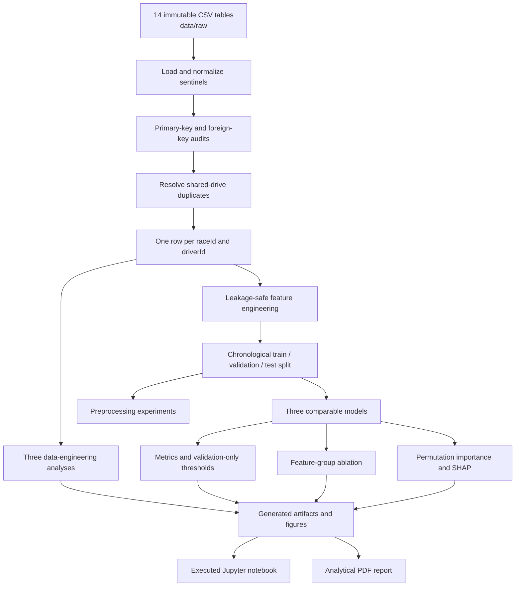

# Formula 1 Podium Prediction Companion

ACL-903 Milestone 1 is a reproducible relational-data and machine-learning pipeline that predicts whether a Formula 1 driver will finish in the top three.

The prediction is made **after qualifying and before the race starts**. Every model feature must be available at that cutoff.

If you are joining the team and wondering where to start, begin hena, then open `src/f1podium/pipeline.py`. The notebook is easier to read, but the pipeline contains the rules everyone shares.

## Project contract

| Item | Definition |
| --- | --- |
| Unit of analysis | One driver entering one race |
| Unique grain | `(raceId, driverId)` |
| Target | `podium = 1` when `positionOrder <= 3`, otherwise `0` |
| Data period | 1950-2024 |
| Training period | 1950-2019 |
| Validation period | 2020-2021 |
| Unseen test period | 2022-2024 |
| Primary metric | PR-AUC |
| Secondary metric | ROC-AUC |
| Compared models | Logistic regression, random forest, shallow neural network |

Current-race results, points, status, laps, pit stops, fastest-lap information, and post-race standings are forbidden as same-race predictors.

## Repository flow



The implementation lives in `src/f1podium/pipeline.py`. The notebook calls the same implementation rather than maintaining a second copy of the analysis.

In simple terms: momken run the analysis from the notebook or from the command line, but both routes must reach the same pipeline code and the same results.

## Core repository contents

```text
ACL-9th-Paladin/
|-- course-materials/                 Official brief and F1 introduction
|-- data/
|   |-- README.md                     Dataset provenance and immutability rule
|   `-- raw/                          Original 14 Kaggle/Ergast CSV tables
|-- notebooks/
|   `-- milestone_1_f1_podium_prediction.ipynb
|                                      Executed, run-all submission notebook
|-- kaggle/
|   `-- f1podium_src.zip               Small source attachment for Kaggle
|-- reports/
|   `-- milestone_1_analytical_report.pdf
|                                      Final structured analytical report
|-- scripts/
|   |-- run_analysis.py               Run the complete analytical pipeline
|   |-- build_notebook.py             Rebuild the notebook source
|   |-- build_report.py               Build the report from artifacts
|   `-- build_kaggle_bundle.py        Package shared source for Kaggle
|-- src/f1podium/
|   |-- __init__.py                   Public package exports
|   `-- pipeline.py                   Cleaning, features, models, evaluation, XAI
|-- tests/
|   `-- test_pipeline.py              Grain, cleaning, split, and leakage tests
|-- pyproject.toml                    Python package and pytest configuration
|-- requirements.txt                  Complete reproducible environment
`-- README.md                         This orientation document
```

Generated `artifacts/`, temporary files, the optional UI/design workspace, deployment metadata, and personal evaluation notes are intentionally excluded from Git.

## How the core files differ

The project deliberately separates implementation, verification, presentation, and document generation. The same analysis should not be independently rewritten in multiple places.

```text
                         +----------------------+
                         |  build_notebook.py   |
                         | notebook structure   |
                         +----------+-----------+
                                    |
                                    v
+------------------+      +----------------------+      +------------------+
| test_pipeline.py | ---> |     pipeline.py      | <--- | Jupyter notebook |
| verifies behavior|      | core implementation  |      | runs + explains  |
+------------------+      +----------+-----------+      +------------------+
                                  |
                                  v
                         +----------------------+
                         | artifacts and figures|
                         +----------+-----------+
                                    |
                                    v
                         +----------------------+
                         |   build_report.py    |
                         | publishes the PDF    |
                         +----------------------+
```

### `src/f1podium/pipeline.py`: the analytical engine

`pipeline.py` contains the reusable project logic. It performs the actual data-science work:

- Loads the 14 raw CSV tables.
- Converts sentinels and semantic types.
- Audits primary and foreign keys.
- Resolves shared-drive duplicates.
- Builds the unique driver-race table.
- Constructs leakage-safe features.
- Creates the chronological splits.
- Trains and evaluates all three models.
- Runs preprocessing and ablation experiments.
- Produces plots, permutation importance, and SHAP explanations.
- Supports complete and partially missing inference records.
- Writes the generated analytical artifacts.

If a feature calculation, cleaning rule, model, metric, or experiment changes, the change normally belongs in `pipeline.py`.

### `tests/test_pipeline.py`: the automated quality inspector

The test file does not perform the final analysis and does not replace `pipeline.py`. It imports pipeline functions, gives them controlled inputs, and verifies that their outputs satisfy important guarantees.

The tests protect behavior such as:

- Correct qualifying-duration parsing.
- Deterministic shared-drive resolution.
- Unique `(raceId, driverId)` grain.
- Correct chronological split boundaries.
- Leakage-safe rolling form.
- A current race result cannot modify its own predictors.
- Non-starters do not enter the mechanical-retirement denominator.
- Cleaning removes duplicate participation without materially shifting the target rate.

A typical test follows this pattern:

```text
Arrange an input -> call a pipeline function -> assert the expected result
```

Tests are evidence that the implementation behaves as intended. They are not evidence that every modeling decision is optimal; those decisions still require EDA, experiments, and written justification.

### `notebooks/milestone_1_f1_podium_prediction.ipynb`: the executable presentation

The notebook imports and executes `pipeline.py`, then presents the resulting tables, figures, and conclusions in the order expected by the evaluator.

It contains:

- Markdown explanations and justification.
- Cleaning and audit output.
- EDA and the three data-engineering answers.
- Feature and split documentation.
- Preprocessing and model comparisons.
- Ablation and XAI results.
- Inference demonstrations and limitations.

The notebook is the project's interactive evidence book. It should not maintain a separate copy of the pipeline logic, because duplicated implementations could silently disagree.

### `scripts/build_notebook.py`: the notebook blueprint

This script programmatically defines the notebook's section order, markdown, code cells, conclusions, tables, and displayed figures. Running it recreates the `.ipynb` file in a reviewable and repeatable way.

```text
build_notebook.py
        -> creates the notebook
        -> the notebook imports pipeline.py
        -> executing the notebook regenerates artifacts
```

When changing notebook wording or organization, edit `build_notebook.py` and regenerate the notebook so the source and final notebook remain consistent.

### `scripts/run_analysis.py`: the command-line start button

This is the smallest runner. It calls the complete pipeline directly without opening Jupyter. Use it to regenerate `artifacts/` from the terminal.

### `scripts/build_report.py`: the PDF publisher

This script reads the generated CSV tables, figures, and summary information from `artifacts/` and turns them into the formal analytical PDF. It is responsible for report prose, tables, figures, captions, and layout; the underlying analytical calculations remain in `pipeline.py`.

### Quick analogy

| File | Analogy | Responsibility |
| --- | --- | --- |
| `pipeline.py` | Engine | Performs the data engineering and machine learning |
| `test_pipeline.py` | Mechanic and inspector | Checks that critical behavior is correct |
| Jupyter notebook | Presentation and laboratory record | Runs the engine and explains the evidence |
| `build_notebook.py` | Notebook blueprint | Recreates the notebook structure and narrative |
| `run_analysis.py` | Start button | Runs the pipeline directly |
| `build_report.py` | Publisher | Turns generated results into the final report |

The main design principle is that `pipeline.py` is the single analytical source of truth. The tests verify it, the notebook demonstrates it, and the report communicates its results.

## Milestone requirements covered

### 1. EDA, cleaning, and auditing

- Programmatic EDA before and after duplicate cleaning.
- Visual comparison of raw and cleaned grain and distributions.
- Literal `\N` sentinel conversion.
- Semantic typing for dates and qualifying durations.
- Primary-key uniqueness and null checks.
- Foreign-key reconciliation checks.
- Immutable raw CSVs; transformations operate on copies.
- Deterministic shared-drive handling:
  1. Prefer a row with a real grid start (`grid > 0`).
  2. Prefer the better finishing classification.
  3. Break remaining ties using the lowest `resultId`.
- Exactly one final row per `(raceId, driverId)`.

The raw `results.csv` contains 26,759 rows. Cleaning resolves 85 duplicate driver-race groups and leaves 26,668 unique modeling rows.

### 2. Data-engineering questions

The notebook and report answer and visualize all three required questions using multi-table joins:

1. Which circuits convert a front-row grid start into a podium most often, and how does the ranking change after 2014?
2. Do drivers podium more often at home after controlling for starting-grid band?
3. Which constructors have the highest mechanical-retirement rates in 2014-2021 and 2022-2024?

Grid and qualifying position remain distinct because penalties can change the final starting order. Mechanical-retirement denominators contain race starters only.

### 3. Feature selection and engineering

The model uses 17 pre-race features in five groups:

| Group | Features |
| --- | --- |
| Grid | `grid_position`, `pit_lane_start`, `front_row`, `field_size` |
| Qualifying | `qualifying_position`, `qualifying_time_seconds`, `qualifying_missing` |
| Form | `driver_podium_rate_5`, `constructor_podium_rate_5`, `driver_races_before` |
| Standings | `driver_points_before`, `driver_rank_before`, `constructor_points_before`, `constructor_rank_before` |
| Context | `driver_age`, `round`, `year` |

Leakage prevention is part of construction:

- Driver form uses `shift()` before the five-race rolling mean.
- Constructor outcomes are aggregated across both cars at race level before shifting and rolling.
- Driver and constructor standings are moved to the following race within the season.
- Grid position `0` becomes a pit-lane flag and is missing in the numeric grid feature; it is never treated as better than pole.

### 4. Preprocessing and splitting

- Missing values are imputed inside the fitted scikit-learn pipeline.
- Logistic regression and the neural network receive standardized inputs.
- The random forest does not require scaling.
- Preprocessing parameters are learned from training rows only.
- Three preprocessing variants are compared on validation:
  - Median imputation with scaling.
  - Median imputation without scaling.
  - Zero imputation with scaling.
- The split is chronological rather than random to prevent future seasons from teaching the model about earlier races.

### 5. Predictive models and evaluation

All models receive the same rows and 17 features:

- Logistic regression: interpretable statistical baseline.
- Random forest: nonlinear tree ensemble.
- Shallow MLP: two hidden layers with 32 and 12 units.

Every model reports ROC-AUC, PR-AUC, F1, precision, and recall. Each model's classification threshold maximizes F1 on validation only and is frozen before test evaluation. PR-AUC is primary because podium rows are rare; ROC-AUC is secondary.

### 6. Experiments and XAI

- Feature-group ablation removes and retrains without grid, qualifying, form, standings, or context.
- Permutation importance explains global validation-score reliance.
- Global SHAP summarizes average feature contribution magnitude.
- Local SHAP explains one validation prediction.
- Explanations are explicitly described as model reliance, **not causal effects**.

### 7. Inference and deliverables

- Reusable inference accepts complete or partially missing pre-race records.
- Missing fields pass through the training-fitted imputer.
- The notebook is sectioned, executed, and Run All-ready.
- The report contains the three written analytical answers, figures, model results, feature justification, XAI, and limitations.

## Environment requirements

Python 3.11 or 3.12 is recommended.

Core libraries:

- pandas and NumPy for relational processing and feature engineering.
- scikit-learn for preprocessing, models, metrics, permutation importance, and pipelines.
- Matplotlib and Seaborn for figures.
- SHAP for global and local explanations.
- Jupyter, nbformat, and nbclient for the executed notebook.
- ReportLab for the analytical PDF.
- pytest for automated checks.

Exact supported version ranges are listed in `requirements.txt` and `pyproject.toml`.

## Setup

From the repository root in PowerShell:

```powershell
py -3.12 -m venv .venv
.\.venv\Scripts\python.exe -m pip install --upgrade pip
.\.venv\Scripts\python.exe -m pip install -r requirements.txt
$env:PYTHONPATH = "src"
```

## Run and verify

Run the tests:

```powershell
.\.venv\Scripts\python.exe -m pytest
```

Run the complete analysis and regenerate `artifacts/`:

```powershell
.\.venv\Scripts\python.exe scripts\run_analysis.py
```

Rebuild and execute the notebook:

```powershell
.\.venv\Scripts\python.exe scripts\build_notebook.py
.\.venv\Scripts\python.exe -m jupyter nbconvert `
  --to notebook `
  --execute notebooks\milestone_1_f1_podium_prediction.ipynb `
  --output milestone_1_f1_podium_prediction.ipynb `
  --ExecutePreprocessor.timeout=1200
```

Rebuild the analytical report after regenerating artifacts:

```powershell
.\.venv\Scripts\python.exe scripts\build_report.py
```

The dependency order is important:

```text
run_analysis.py or executed notebook
                -> artifacts/
                -> build_report.py
                -> reports/milestone_1_analytical_report.pdf
```

## Kaggle notebook

The repository notebook is also the Kaggle submission notebook. We intentionally do not keep a second analytical notebook, because two copies momken drift and show different numbers.

The only difference is where inputs come from:

| Environment | Raw data | Pipeline source | Generated artifacts |
| --- | --- | --- | --- |
| Local repository | `data/raw/` | `src/f1podium/` | `artifacts/` |
| Kaggle | Attached dataset under `/kaggle/input/` | Attached `f1podium_src.zip` | `/kaggle/working/artifacts/` |

Prepare the small source attachment:

```powershell
.\.venv\Scripts\python.exe scripts\build_kaggle_bundle.py
```

This creates:

```text
kaggle/f1podium_src.zip
```

To publish on Kaggle:

1. Create or open a Kaggle notebook.
2. Import `notebooks/milestone_1_f1_podium_prediction.ipynb`.
3. Attach the public Formula 1 World Championship dataset containing the 14 CSV tables.
4. Upload or attach `kaggle/f1podium_src.zip` as a private Kaggle dataset/input.
5. Choose **Run All**.
6. Confirm that every code cell completes and that tables and figures appear.
7. Save a version with outputs, then make the notebook accessible using the visibility required for submission.

The first notebook cell automatically searches `/kaggle/input` for `results.csv` and either an unpacked `f1podium/pipeline.py` or the ZIP bundle. Hena Kaggle-specific work is limited to path discovery; the analysis itself stays identical.

## Automated tests

`tests/test_pipeline.py` verifies:

1. Qualifying-duration parsing.
2. Shared-drive selection behavior.
3. Real modeling-table grain, features, and split boundaries.
4. Rolling-form leakage prevention.
5. Deterministic duplicate cleaning under randomized row order.
6. Correct race-start denominator for mechanical retirements.
7. Current-race results cannot change their own feature values.
8. Before/after cleaning EDA reaches unique driver-race grain without materially shifting the target rate.

## Verified headline results

- 26,668 unique driver-race rows after cleaning.
- 12.7% overall podium rate.
- Zero null or duplicated audited primary keys.
- Zero orphan values in the audited foreign-key relationships.
- The shallow neural network has the highest validation PR-AUC and remains slightly first on the unseen test set.
- Grid is the most important feature group under ablation, permutation importance, and SHAP.
- The random forest shows the largest training-to-validation performance drop.

Exact scores, thresholds, plots, and sample sizes are stored in the executed notebook and analytical report rather than duplicated here.

## Known limitations

- Qualifying coverage is sparse and era-dependent in older seasons.
- Formula 1 regulations, field sizes, reliability, and competitive structure change over time.
- Constructor identifiers do not necessarily preserve history across team renames.
- The home-country analysis uses a documented but incomplete nationality-to-country mapping.
- Mechanical-status classification is rules-based and may miss rare ambiguous failures.
- The validation set contains only 39 races from 2020-2021.
- Model probabilities were evaluated for ranking and threshold performance, not formal calibration.
- Permutation importance and SHAP explain associations inside fitted models, not causes of podium finishes.

## Collaboration rules

- Do not edit files in `data/raw/`.
- Put reusable analysis logic in `src/f1podium/pipeline.py`, not only in notebook cells.
- Add or update tests when changing grain, joins, leakage controls, features, or evaluation behavior.
- Regenerate the notebook and report after changing analysis results.
- Do not commit `artifacts/`, temporary renders, local environments, the optional UI/design workspace, or personal study notes.
- Never select models, hyperparameters, or thresholds using the test set.

## Team ownership

The checklist annotations use these initials:

| Initial | Team member | Color in the checklist |
| --- | --- | --- |
| Y | Yahia | Blue |
| R | Rana | Red |
| A | Ali | Black |
| A* | Aya | Green |

Ownership means that person should understand, maintain, present, and defend the assigned work. Everyone should still understand the complete pipeline because evaluation questions may be directed to any team member.

### Yahia (Y): EDA, analytical questions, and feature evidence

Yahia primarily owns the exploratory and descriptive analysis.

Checklist scope:

- Initial exploratory data analysis.
- Data-analysis plots.
- The three data-engineering questions, shared with Rana where joins or interpretation overlap.
- Plots and written notebook conclusions for the three questions.
- Exploratory evidence supporting feature selection.
- Plots showing feature effects.
- Explanation of why the form features use past races only.

Main code locations:

- `src/f1podium/pipeline.py`
  - `cleaning_eda`
  - `engineering_answers`
  - `create_plots`
  - `FEATURE_GROUPS` and `FEATURES`
- `scripts/build_notebook.py`
  - Sections 2, 3, and 4.
- `scripts/build_report.py`
  - Cleaning-impact EDA, qualifying coverage, the three analytical answers, and feature motivation.
- `artifacts/front_row_circuits.csv`
- `artifacts/home_effect.csv`
- `artifacts/mechanical_retirements.csv`
- `artifacts/figures/qualifying_coverage.png`
- `artifacts/figures/front_row_conversion.png`
- `artifacts/figures/home_effect.png`
- `artifacts/figures/mechanical_retirements.png`

Yahia should be able to explain:

- What changed before and after cleaning and why the distribution remained stable.
- Why final grid, not qualifying position, defines a front-row start.
- Why grid bands are used to control starting position in the home-race analysis.
- Which statuses and denominators define a mechanical retirement.
- How qualifying coverage motivated the missingness flag and retention of grid features.
- Why descriptive results and feature importance are associations rather than causal effects.

Expected handoff:

- Provide Ali with clearly documented cleaning/EDA observations.
- Provide Aya with evidence motivating preprocessing and feature design.
- Provide Rana with the descriptive evidence used to interpret model behavior.
- Confirm that every analytical answer appears as a table, plot, and explicit markdown conclusion.

### Rana (R): predictive models, evaluation, ablation, and XAI

Rana primarily owns modeling and explainability. The marked checklist also indicates shared responsibility with Yahia for the three analytical questions, especially where those findings support model interpretation.

Checklist scope:

- Logistic-regression baseline.
- Random-forest model.
- Shallow feed-forward neural network.
- Explanation of how each model works.
- Model limitations.
- Training and validation performance.
- Unseen test performance.
- Model-comparison plots and tables.
- Feature-group ablation.
- Global permutation importance.
- Global SHAP.
- Local SHAP explanation.
- XAI plots and interpretation in the report.

Main code locations:

- `src/f1podium/pipeline.py`
  - `_pipeline`
  - `model_definitions`
  - `_best_threshold`
  - `_metrics`
  - `train_and_evaluate`
  - `ablation_experiments`
  - `create_plots`
  - `shap_explanations`
  - `predict_podium`
- `scripts/build_notebook.py`
  - Sections 6, 7, 8, 9, and 10.
- `scripts/build_report.py`
  - Model comparison, ablation, XAI, inference, conclusions, and limitations.
- `artifacts/model_metrics.csv`
- `artifacts/ablation_results.csv`
- `artifacts/figures/model_comparison.png`
- `artifacts/figures/permutation_importance.*`
- `artifacts/figures/shap_global.*`
- `artifacts/figures/shap_local.*`

Rana should be able to explain:

- Why logistic regression is the baseline.
- How a random forest and a two-hidden-layer MLP work.
- Why all models use identical rows and features.
- Why PR-AUC is primary and ROC-AUC is secondary.
- Precision, recall, F1, ROC-AUC, PR-AUC, and validation-only threshold selection.
- Why the random forest shows overfitting.
- Why test data cannot be used for model, hyperparameter, or threshold selection.
- Why permutation importance and SHAP can disagree.
- Why local SHAP satisfies the official local-XAI requirement without LIME.
- Why XAI results must not be presented as causal effects.

Expected handoff:

- Receive the locked features and splits from Aya.
- Receive domain interpretations from Yahia.
- Confirm with Ali that no post-race column enters the model.
- Return final metrics, figures, selected thresholds, ablations, and explanations for the notebook and report.

### Ali (A): cleaning, relational integrity, and integration

Ali primarily owns data cleaning, auditing, modeling grain, and final integration. Ali also shares feature-selection responsibility with Aya because cleaning decisions determine which candidate features are valid and available.

Checklist scope:

- Raw-table loading and immutability.
- Sentinel handling and semantic typing.
- Primary-key and foreign-key audits.
- Shared-drive duplicate discovery and documented resolution.
- Final one-row-per-`(raceId, driverId)` grain.
- Join correctness and relationship validation.
- Integration of feature-selection reasoning with data availability.
- Notebook/report assembly and final submission checks.

Main code locations:

- `src/f1podium/pipeline.py`
  - `load_raw_tables`
  - `audit_tables`
  - `_time_to_seconds`
  - `clean_results`
  - `build_modeling_table`
  - `cleaning_eda`
  - `run_analysis`
- `tests/test_pipeline.py`
  - Duration parsing.
  - Duplicate rules and determinism.
  - Modeling-table grain.
  - Cleaning-impact checks.
  - Current-race leakage mutation test.
- `data/README.md`
- `README.md`
- `scripts/run_analysis.py`
- `scripts/build_notebook.py`
- `scripts/build_report.py`

Ali should be able to explain:

- The purpose and grain of every important raw table.
- How `\N` becomes a missing value and how dates/durations receive semantic types.
- The difference between primary-key and foreign-key validation.
- Why `validate="many_to_one"` and `validate="one_to_one"` protect joins.
- Why shared drives violate the required modeling grain.
- The exact deterministic rule for retaining a shared-drive row.
- Why grid zero becomes a pit-lane flag instead of numeric pole position.
- How the complete pipeline flows from raw CSVs to artifacts, notebook, and report.
- Which files are generated, ignored, or intended for submission.

Expected handoff:

- Give Yahia an audited, cleaned, unique driver-race table.
- Agree with Aya on semantic transformations and pre-race availability.
- Audit Rana's final feature matrix for leakage before accepting model results.
- Run the full tests, execute the notebook, rebuild the report, and verify submission links.

### Aya (A*): preprocessing, feature engineering, and splitting

Aya primarily owns the transformation from the cleaned table into a leakage-safe model-ready dataset. Feature selection is shared with Ali and supported by Yahia's EDA.

Checklist scope:

- Data preprocessing.
- Feature engineering.
- Effects of preprocessing on feature values, ranges, and distributions.
- Preprocessing experiments.
- Leakage-safe driver and constructor form.
- Prior driver and constructor standings.
- Proper training, validation, and test splitting.
- Feature-list documentation and pre-race validity.

Main code locations:

- `src/f1podium/pipeline.py`
  - `FEATURE_GROUPS` and `FEATURES`
  - `_previous_standings`
  - `build_modeling_table`
  - `split_by_time`
  - `_pipeline`
  - `preprocessing_experiments`
- `scripts/build_notebook.py`
  - Sections 4 and 5.
- `scripts/build_report.py`
  - Feature table, chronological split, and preprocessing experiment sections.
- `artifacts/preprocessing_experiments.csv`
- `artifacts/modeling_table.csv`

Aya should be able to explain:

- All 17 features and their five groups.
- Why every feature is available after qualifying and before race start.
- Why driver form uses `shift()` before `rolling()`.
- Why constructor outcomes are aggregated by race before shifting.
- Why standings must be attached to the following race.
- How median imputation and standardization work.
- Why preprocessing is fitted on training only.
- Why trees do not require scaling but logistic regression and the MLP benefit from it.
- The three preprocessing variants and their validation results.
- Why the split is chronological rather than random.
- Why training has more qualifying missingness and a lower podium rate than later splits.

Expected handoff:

- Receive the cleaned driver-race grain from Ali.
- Use Yahia's EDA to justify missingness and feature choices.
- Deliver a locked feature list and chronological split to Rana.
- Confirm that inference uses the same training-fitted preprocessing pipeline.

### Shared ownership and review

Some outputs require more than one owner:

| Output | Primary owner | Required reviewers |
| --- | --- | --- |
| Cleaning and key audits | Ali | Yahia |
| Before/after EDA | Yahia | Ali |
| Three data-engineering answers | Yahia | Rana and Ali |
| Feature list and cutoff validity | Aya | Ali and Yahia |
| Preprocessing experiments | Aya | Rana |
| Chronological split | Aya | Ali and Rana |
| Model comparison | Rana | Aya |
| Feature-group ablation | Rana | Yahia and Aya |
| Global and local XAI | Rana | Yahia |
| Executed notebook | Ali | All members |
| Analytical report | Ali | All members |
| Final submission links | Ali | One second reviewer before submission |

### Recommended Git workflow

- Create focused branches such as `yahia-eda`, `rana-modeling`, `ali-cleaning`, and `aya-features`.
- Keep commits limited to one responsibility whenever possible.
- Pull the latest shared branch before editing generated notebook/report outputs.
- Avoid editing the same generated notebook or PDF in parallel; update source scripts first, then let one person regenerate them.
- Run `python -m pytest` before requesting review.
- Never commit `artifacts/`, caches, local environments, UI files, temporary renders, or personal study notes.
- Do not commit directly to the shared branch until another team member has reviewed the relevant outputs.

## Submission outputs

The core files intended for review are:

- `notebooks/milestone_1_f1_podium_prediction.ipynb`
- `reports/milestone_1_analytical_report.pdf`
- `src/f1podium/pipeline.py`
- `tests/test_pipeline.py`
- `data/raw/*.csv`

Before submission, confirm that the Kaggle notebook link and GitHub repository link are accessible to the evaluator.
